# 学事通 · CampusPedia

> 传智杯 · AI 创新应用挑战赛参赛作品
>
> **10 分钟极速复现指南**：环境配置说明 / 依赖清单 / 环境变量模板 / 逐步命令 / 验收清单 / 故障排查。
> 面向「刚拿到压缩包或刚克隆仓库」的朋友，从零开始照做即可启动。命令可直接复制执行，覆盖 **Windows（PowerShell + Git Bash）** 与 **macOS / Linux**。

---

## 1. 项目一句话简介

把学校公开制度文档（学籍、奖助、处分、宿舍、就业、医保等）导入后，用「**混合检索 + RRF 融合 + 重排 + 大模型**」提供流式问答、答案 **来源溯源**、检索过程可视化的一站式体验，支持普通用户 / 管理员 **两级权限**。

核心能力（保留表述，便于对照验收）：

- 流式问答 + 答案 `[来源N]` **来源溯源**引用（可点击跳转官网原文）
- **混合检索**：向量（pgvector）+ 关键词（MySQL 8 全文 ngram）+ **RRF** 融合，再 **Rerank 重排** + 相关性阈值过滤
- Query 改写 + 多轮对话上下文记忆 + 思考过程可视化
- **两级权限**：普通用户（会话持久化）/ 管理员（`/admin` 后台）
- 管理后台：语料上传（md/txt/pdf/doc/docx）、向量化、参数配置、ECharts 数据大屏

> 界面演示截图见文末 **第 12 节**（含登录、问答溯源、语料管理、数据大屏、参数配置等）。

## 2. 技术栈

| 层 | 选型 |
|---|---|
| 前端 | **Vue 3 + TypeScript + Vite 5 + Element Plus + Pinia + ECharts** |
| 后端 | **Java 17 + Spring Boot 4.1 + MyBatis-Plus + Spring Security + JWT** |
| LLM 生成 | **DeepSeek `deepseek-chat`，SSE 流式** |
| Embedding / Rerank | **DashScope**：`qwen3.7-text-embedding-flash`（1024 维）/ `qwen3.7-text-rerank`；可降级为 `hash` 免密钥 |
| 向量库 | **pgvector**（`vector(1024)`，Docker 持久化） |
| 关系库 | **MySQL 8**（元数据 + 全文 ngram 检索） |
| 缓存 | **Redis 7**：容器与依赖保留，**业务未启用缓存** |

## 3. 前置环境（环境配置说明）

| 工具 | 版本要求 | 核对命令 / 说明 |
|---|---|---|
| Docker Desktop | 最新稳定版，含 Docker Compose v2 | `docker compose version`；Windows 需开启 WSL2 / 虚拟化。提供 `mysql:8`、`redis:7`、`pgvector/pgvector:pg16` |
| JDK | **17** | `java -version`；Spring Boot 4.1.2 要求 Java 17 |
| Node.js | **18+（含 npm）**，建议 20 LTS | `node -v`、`npm -v`；CI 使用 Node 20 |
| Git | 任意新版 | 用于克隆仓库；本指南不执行任何 git 写操作 |

**端口占用说明**（启动前确认以下 5 个端口空闲）：

| 端口 | 服务 | 备注 |
|---|---|---|
| **5173** | 前端 Vite | 被占用时 Vite 自动改用 5174，验收地址随之变化 |
| **8081** | 后端 Spring Boot | **为避开本机 8080 被占用**而固定 8081；前端 `/api` 代理到此端口 |
| **3307** | MySQL 8 | 容器 3306 映射到宿主机 3307 |
| **5432** | pgvector（PostgreSQL 16） | 向量库 |
| **6379** | Redis 7 | 预留，业务未启用 |

## 4. 依赖清单

### 4.1 后端 `backend/pom.xml` 关键依赖

| 依赖 | 版本 | 作用 |
|---|---|---|
| `spring-boot-starter-parent` | 4.1.2 | 父 POM，统一版本 |
| `spring-boot-starter-webmvc` | 继承 | REST / Web |
| `spring-boot-starter-security` | 继承 | 鉴权、两级权限 |
| `spring-boot-starter-data-redis` | 继承 | Redis 依赖保留，业务未启用 |
| `mybatis-plus-spring-boot4-starter` | 3.5.16 | ORM |
| `mybatis-plus-jsqlparser` | 3.5.16 | SQL 解析 |
| `jackson-databind` | 2.18.2 | JSON |
| `mysql-connector-j` | 继承（runtime） | MySQL 8 驱动 |
| `postgresql` | 继承（runtime） | pgvector 驱动 |
| `jjwt-api` / `jjwt-impl` / `jjwt-jackson` | 0.12.6 | JWT 签发与校验 |
| `lombok` | 继承 | 样板代码 |
| `pdfbox` | 3.0.3 | PDF 语料解析 |
| `poi-scratchpad` / `poi-ooxml` | 5.2.5 | doc / docx 语料解析 |
| `spring-boot-starter-test` | 继承（test） | JUnit 5 + Mockito，**34 例** |

### 4.2 前端 `client/package.json` 依赖

| 分类 | 依赖 | 版本 |
|---|---|---|
| 运行时 | `vue` | ^3.5.13 |
| 运行时 | `vue-router` | ^4.4.5 |
| 运行时 | `pinia` | ^2.2.6 |
| 运行时 | `element-plus` | ^2.8.8 |
| 运行时 | `@element-plus/icons-vue` | ^2.3.1 |
| 运行时 | `echarts` | ^5.5.1 |
| 运行时 | `axios` | ^1.7.7 |
| 运行时 | `markdown-it` | ^14.1.0 |
| 开发 | `vite` | ^5.4.11 |
| 开发 | `@vitejs/plugin-vue` | ^5.2.0 |
| 开发 | `typescript` | ^5.6.3 |
| 开发 | `vue-tsc` | ^2.1.10 |
| 开发 | `vitest` | ^2.1.9 |
| 开发 | `jsdom` | ^25.0.1 |

脚本：`dev` = `vite`，`build` = `vue-tsc -b && vite build`，`test` = `vitest run`，`preview` = `vite preview`。`client/package-lock.json` 已随仓库提供，`npm ci` 可直接使用。

---

## 5. 10 分钟极速复现（严格按第 0 → 4 步执行）

> 以下命令除特别标注外，均在**仓库根目录**执行。Windows 用户任选 **Git Bash** 或 **PowerShell**，两套命令都已给出。

### 第 0 步 · 准备环境变量（必做，否则后端启动失败）

- **做什么**：复制模板为 `.env`，填入真实值，并把变量导出到「即将启动后端」的那个终端。

- **命令 · 复制模板**

```bash
# Git Bash / macOS / Linux
cp .env.example .env
```

```powershell
# PowerShell
copy .env.example .env
```

- **命令 · 环境变量模板（6 个键名）**

```dotenv
# .env —— 前 5 个键来自 .env.example；第 6 个 EMBEDDING_PROVIDER 为「可选」
MYSQL_ROOT_PASSWORD=请改成强密码
POSTGRES_PASSWORD=请改成强密码
DEEPSEEK_API_KEY=sk-xxxxxxxxxxxxxxxx
DASHSCOPE_API_KEY=sk-xxxxxxxxxxxxxxxx
JWT_SECRET=请改成至少32字节的随机字符串
EMBEDDING_PROVIDER=hash
```

- **逐项说明（必填与用途）**

| 键名 | 必填 | 用途 |
|---|---|---|
| `MYSQL_ROOT_PASSWORD` | **必填** | MySQL 8 root 密码。`docker-compose.yml` 用它初始化容器，`application.yml` 用它连库，第 2 步建表也用它 |
| `POSTGRES_PASSWORD` | **必填** | pgvector 容器 `campus` 用户密码，后端连向量库用 |
| `DEEPSEEK_API_KEY` | **必填** | DeepSeek `deepseek-chat` 流式生成答案的密钥。**生成答案必须 DeepSeek Key**，缺失则提问拿不到流式输出 |
| `DASHSCOPE_API_KEY` | 选填 | DashScope embedding / rerank 密钥。仅当 `EMBEDDING_PROVIDER=dashscope` 或启用 rerank 时需要；不填时 rerank 降级为**纯混合检索** |
| `JWT_SECRET` | **必填** | JWT 签名密钥，**至少 32 字节**；可以让ai生成32字节签名密钥填进去，留空或不足 32 字节，后端启动即 **fail-fast** |
| `EMBEDDING_PROVIDER` | **可选** | 默认 `hash`（免密钥、离线、1024 维）；设为 `dashscope` 走千问 embedding。不写此键时 `application.yml` 的 `${EMBEDDING_PROVIDER:hash}` 同样默认 `hash` |

- **三条必须记住的规则**

> 1. `.env` **已被 `.gitignore` 忽略**，不会进仓库，密钥不入库。
> 2. `docker compose` **会自动读取 `.env`**；但 **Spring Boot 不读 `.env`**——`application.yml` 通过 `${MYSQL_ROOT_PASSWORD:}`、`${DEEPSEEK_API_KEY:}`、`${JWT_SECRET:}` 等占位符读取**进程环境变量**。
> 3. 因此**后端进程所在终端必须单独导出变量**；**每新开一个终端都要重新导出一次**。

- **命令 · 导出变量到当前终端**

```bash
# Git Bash / macOS / Linux（仓库根目录执行）
set -a; . ./.env; set +a
```

```powershell
# PowerShell（仓库根目录执行，逐行解析 .env）
Get-Content .env | ForEach-Object { if ($_ -match '^([A-Z_]+)=(.*)$') { [Environment]::SetEnvironmentVariable($Matches[1], $Matches[2], 'Process') } }
```

- **预期结果**：`.env` 已生成；执行 `echo $JWT_SECRET`（Git Bash / macOS / Linux）或 `$env:JWT_SECRET`（PowerShell）能回显非空值；`DEEPSEEK_API_KEY` 为真实 Key。

- **出错怎么办**：报 `No such file or directory` → 确认当前在仓库根目录且 `.env` 已创建；后端仍提示 JWT 为空或 DeepSeek 401 → 变量**没有在启动后端的那个终端**导出，回到本步重新执行导出命令后重启后端。

### 第 1 步 · 启动基础设施

- **做什么**：一键拉起 MySQL 8、Redis 7、pgvector 三个容器。

- **命令**（Windows / macOS / Linux 通用）

```bash
docker compose up -d
```

- **预期结果**：`docker compose ps` 显示 `mysql`、`redis`、`pgvector` 均为 running；首次拉取镜像需等待。

- **出错怎么办**：Docker Desktop 未启动 → 先启动并确认 WSL2 / 虚拟化已开启；报 `port is already allocated` → 见第 7 节排错表第 1 条；镜像拉取慢 → 耐心等待或配置镜像加速。

### 第 2 步 · 初始化数据库（建表 + 基础数据）

- **做什么**：执行两个建表脚本。密码取自第 0 步导出的环境变量，**新开终端请先重新导出**。

- **命令 · Git Bash / macOS / Linux**

```bash
docker compose exec -T mysql mysql -uroot -p"$MYSQL_ROOT_PASSWORD" --default-character-set=utf8mb4 campus_pedia < sql/init.sql
docker compose exec -T pgvector psql -U campus -d campus_pedia < sql/init_pgvector.sql
```

- **命令 · PowerShell**（PowerShell 不支持 `<` 输入重定向，改用管道）

```powershell
Get-Content sql/init.sql -Raw | docker compose exec -T mysql mysql -uroot -p"$env:MYSQL_ROOT_PASSWORD" --default-character-set=utf8mb4 campus_pedia
Get-Content sql/init_pgvector.sql -Raw | docker compose exec -T pgvector psql -U campus -d campus_pedia
```

- **预期结果**：
  - `sql/init.sql`：建 **9 张表**，写入 **7 个语料分类**（学籍与教学管理 / 学生管理 / 学生奖助 / 素质拓展 / 学生就业 / 医疗保障 / 其他）与 **11 条系统配置**（切片、召回、阈值、重排、系统提示词等）。全部用 `INSERT IGNORE`/`IF NOT EXISTS`，可重复执行。
  - `sql/init_pgvector.sql`：建 `vector_store` 表，`embedding` 为 **`vector(1024)`**。
  - 无报错输出；MySQL 打印 `Using a password on the command line interface can be insecure` 警告可忽略。

- **出错怎么办**：`Access denied for user 'root'` → 密码未导出或与 `.env` 不一致，回第 0 步；`Unknown parser ngram` → 见排错表第 6 条；`Connection refused` → 容器未就绪，等 `docker compose ps` 显示 running 后重试。

### 第 3 步 · 启动后端（端口 8081）

- **做什么**：用 Maven Wrapper 启动 Spring Boot。

- **命令**

```bash
# Git Bash / macOS / Linux
cd backend && ./mvnw spring-boot:run
```

```powershell
# PowerShell（Windows 用 mvnw.cmd）
cd backend; .\mvnw.cmd spring-boot:run
```

- **预期结果**：日志出现 `Started CampusPediaApplication` 与 `Tomcat started on port 8081`；`curl -i http://localhost:8081/api/notice` 返回 **200**。首次构建需下载 Maven 依赖，请等待。

- **关于 Embedding 模式（重要）**

> 默认 `EMBEDDING_PROVIDER=hash`：**免密钥、离线可跑**；`hash` 与 `dashscope` 两种 provider **都输出 1024 维**，与 `sql/init_pgvector.sql` 的 `vector(1024)` 一致。
>
> 切到千问：导出 `EMBEDDING_PROVIDER=dashscope` 并填好 `DASHSCOPE_API_KEY`。**无 DashScope 密钥时 rerank 自动降级为纯混合检索**；但**生成答案仍需 DeepSeek 密钥**。

```bash
# Git Bash / macOS / Linux
export EMBEDDING_PROVIDER=dashscope
```

```powershell
# PowerShell
$env:EMBEDDING_PROVIDER = 'dashscope'
```

- **出错怎么办**：启动抛 `IllegalStateException: campus.jwt.secret 未配置或不足 32 字节` → 见排错表第 2 条；连不上 MySQL / pgvector → 第 3 条；DeepSeek 401 → 第 4 条；改动 provider 后需**重启后端**生效。

### 第 4 步 · 启动前端（端口 5173）

- **做什么**：锁定依赖并启动 Vite 开发服务器。

- **命令**

```bash
# Git Bash / macOS / Linux
cd client && npm ci && npm run dev
```

```powershell
# PowerShell
cd client; npm ci; npm run dev
```

- **预期结果**：终端输出 `VITE ready` 与 `Local: http://localhost:5173/`；`client/vite.config.ts` 已把 `/api` 代理到 `http://localhost:8081`。

- **出错怎么办**：`npm ci` 失败 → 见排错表第 5 条；5173 被占时 Vite 自动改用 5174，注意验收地址；Node < 18 报引擎错误 → 升级到 18+ 或 20 LTS。

---

## 6. 验收清单

按序核对，全部通过即复现成功：

1. 浏览器打开 **http://localhost:5173** → 登录页正常显示（背景图为 Unsplash；离线时显示兜底渐变色，非白屏）。
2. **注册 → 登录**（注册默认 `role=user`，即两级权限中的普通用户）。
3. 提问 **「转专业需要什么条件？」** → 看到 **SSE 流式输出**、答案中的 **`[来源N]` 来源溯源**引用（可点击跳转官网原文）与检索过程可视化。若返回「资料不足」，先在 `/admin` → 语料管理上传 `corpus/example/` 下文档并点击向量化。
4. **左侧会话**列表出现新会话，刷新页面后仍在（会话持久化）。
5. 用**管理员账号（`role=admin`）**登录 → 访问 **`/admin`** → 可查看语料管理 / 参数配置 / ECharts 数据大屏。暂无管理员账号时，可在 MySQL 中把自己账号的 `role` 置为 `admin`：

```bash
docker compose exec -T mysql mysql -uroot -p"$MYSQL_ROOT_PASSWORD" campus_pedia -e "UPDATE t_user SET role='admin' WHERE student_no='你的学号';"
```

6. **后端健康检查（权限边界）**

```bash
# Git Bash / macOS / Linux
curl -i http://localhost:8081/api/notice        # 预期 HTTP/1.1 200（GET 公开）
curl -i http://localhost:8081/api/admin/users   # 预期 HTTP/1.1 403（未带管理员 token）
```

```powershell
# PowerShell：curl 是 Invoke-WebRequest 别名，请用 curl.exe
curl.exe -i http://localhost:8081/api/notice
curl.exe -i http://localhost:8081/api/admin/users
```

## 7. 常见故障排查表

| # | 现象 | 原因 | 处理 |
|---|---|---|---|
| 1 | `docker compose up -d` 报 `port is already allocated`；或 Vite 起在 5174 | 5173 / 8081 / 3307 / 5432 / 6379 被占 | Windows `netstat -ano \| findstr :3307`、macOS/Linux `lsof -i :3307` 查占用进程并停止；后端固定 8081 就是为避开本机 8080；Vite 自动换端口后按实际地址验收 |
| 2 | 后端启动抛 `IllegalStateException: campus.jwt.secret 未配置或不足 32 字节` | `JWT_SECRET` 为空或 < 32 字节，`JwtUtil` 启动校验 **fail-fast** | 在 `.env` 填 ≥ 32 字节随机串 → 重新执行第 0 步导出 → 重启后端 |
| 3 | 后端报 `Communications link failure` / `Connection refused` | 容器未就绪，或 `MYSQL_ROOT_PASSWORD` / `POSTGRES_PASSWORD` 与容器不一致 | `docker compose ps` 确认 running；等 MySQL 首次初始化完成再执行第 2 步；核对 `.env` 并重新导出 |
| 4 | 容器正常，但后端报密码错误 / DeepSeek 401 / JWT 空 | `.env` 变量**没导出到后端所在终端**（Spring Boot 不读 `.env`） | 在启动后端的那个终端执行第 0 步导出命令；**每新开终端都要重来**；也可用 IDE Run Configuration 注入环境变量 |
| 5 | `npm ci` 失败 | Node 版本过低、lock 文件不一致、网络问题 | 确认 Node 18+（建议 20 LTS）；确认 `client/package-lock.json` 存在；删除 `client/node_modules` 后重试；`npm ci` 要求 lock 与 `package.json` 严格一致 |
| 6 | 执行 `init.sql` 报 `Unknown parser ngram` / 全文索引创建失败 | 用了非 MySQL 8 的实例（如 MariaDB / MySQL 5.7）；`ft_name`、`ft_content` 依赖内置 **ngram FULLTEXT 解析器** | 必须用 `docker-compose.yml` 指定的 `mysql:8`；勿替换镜像；中文关键词检索依赖该解析器 |
| 7 | 语料向量化失败：`expected 1024 dimensions, got N` | 向量维度不一致 | `sql/init_pgvector.sql` 固定 `vector(1024)`，`application.yml` 的 `campus.embedding.dimensions=1024`；`hash` 与 `dashscope` 都输出 1024 维，勿改维度；若曾改过，重建 `vector_store` 并重新向量化 |
| 8 | 连续登录 / 注册返回 `{"code":429,"msg":"请求过于频繁，请稍后再试"}` | `RateLimitFilter` 按 IP 滑动窗口限流：登录 / 注册 **10 次/分钟**、问答 **20 次/分钟** | 属正常保护，等 60 秒窗口过去再试；勿用脚本高频重试 |
| 9 | 登录页 Unsplash 背景图加载不出 | 离线 / 外网不通 | `client/src/style.css` 已保留**兜底色**防离线白屏，不影响任何功能；联网后自动显示 |
| 10 | 注册提示「该学号已被注册」 | `t_user.student_no` 唯一键约束 | 换一个学号，或直接登录已有账号；`init.sql` 用 `INSERT IGNORE` 可重复执行、不会覆盖已有账号 |

## 8. 测试与构建

- **命令 · Git Bash / macOS / Linux**（仓库根目录执行，三条可直接整体复制）

```bash
(cd backend && ./mvnw -B test)     # 后端 JUnit 5，34 例
(cd client && npm test)            # 前端 vitest，7 例
(cd client && npm run build)       # vue-tsc 类型检查 + 生产构建
```

- **命令 · PowerShell**

```powershell
Push-Location backend; .\mvnw.cmd -B test; Pop-Location
Push-Location client; npm test; Pop-Location
Push-Location client; npm run build; Pop-Location
```

- **预期结果**：后端 `Tests run: 34`、前端 `7 passed`、构建产出 `client/dist/`。

- **出错怎么办 · Windows 宿主 esbuild 删除系统 Temp 临时文件被拒**

> 现象：`npm ci` / `npm run build` 报 esbuild 清理 `%TEMP%` 临时文件 `EPERM`。**属环境问题，非代码缺陷。**
> 处理：把 `TEMP` / `TMP` 重定向到项目内目录 `client/.tmp/esbuild-temp` 再执行（该目录仅供本机构建，可按需清理）。

```powershell
# PowerShell（在仓库根目录执行）
New-Item -ItemType Directory -Force client/.tmp/esbuild-temp | Out-Null
$env:TEMP = (Resolve-Path client/.tmp/esbuild-temp).Path
$env:TMP  = $env:TEMP
Push-Location client; npm ci; npm run build; Pop-Location
```

```bash
# Git Bash（Windows）
mkdir -p client/.tmp/esbuild-temp
export TEMP="$(pwd)/client/.tmp/esbuild-temp" TMP="$(pwd)/client/.tmp/esbuild-temp"
(cd client && npm ci && npm run build)
```

- **CI**：见 `.github/workflows/ci.yml`——push 到 `main` 或 PR 时自动跑后端测试（JDK 17 temurin）、前端 `npm ci` + `npm test` + `npm run build`（Node 20）。

## 9. 目录结构

```
CampusPedia/
├── .env.example                  # 环境变量模板（复制为 .env）
├── .github/workflows/ci.yml      # CI：后端测试 + 前端测试/构建
├── docker-compose.yml            # mysql(3307) + redis(6379, 预留) + pgvector(5432)
├── backend/                      # Spring Boot 4.1 后端
│   ├── mvnw / mvnw.cmd           # Maven Wrapper（Windows 用 .cmd）
│   ├── pom.xml                   # 依赖清单
│   └── src/main/java/com/campuspedia/
│       ├── rag/                  # RAG 核心：混合检索 / RRF / 重排 / 改写 / 向量库 / 文档加载
│       ├── controller/           # REST 控制器（/api/auth、/api/chat、/api/notice、/api/admin/users…）
│       ├── service/              # 知识库 / 配置 / LLM / Embedding 服务
│       ├── entity + mapper/      # 9 套 MyBatis-Plus 实体与映射
│       └── security/             # JWT 过滤器、限流过滤器与鉴权
├── client/                       # Vue 3 前端（package.json / package-lock.json / vite.config.ts / src/）
├── corpus/                       # 教务语料（corpus/example/ 含「学籍与教学管理-转专业条件.md」等）
├── sql/
│   ├── init.sql                  # MySQL：9 表 + 7 分类 + 11 配置（ngram 全文索引）
│   └── init_pgvector.sql         # pgvector：vector_store，embedding vector(1024)
└── docs/                         # 参赛材料 + Prompt 快照 + 架构图
```

## 10. 数据库 9 张表说明（`sql/init.sql`）

| 表 | 说明 |
|---|---|
| `t_user` | 用户表：学生与管理员账号，`role=user/admin` 支撑**两级权限**，`student_no` 唯一 |
| `t_kb_category` | 语料分类表：7 个分类，含「其他」兜底分类 |
| `t_kb_document` | 语料文档表：上传文件、`source_url` 官网原文链接、向量化状态、`file_name` 带 ngram 全文索引 |
| `t_doc_chunk` | 文档切片表：检索单元，`content` 带 ngram 全文索引，`vector_id` 关联 pgvector |
| `t_chat_session` | 会话表：一次多轮对话，支撑左侧会话列表 |
| `t_chat_message` | 消息表：问答正文、`sources` **来源溯源**、改写 query、命中数、耗时、token 统计 |
| `t_notice` | 公告表：置顶优先展示（`/api/notice` GET 公开） |
| `t_sys_config` | 系统配置表：11 条 RAG 参数与系统提示词（键值对，`/admin` 可调） |
| `t_sys_log` | 问答日志表：操作审计，当前只写入、无读取接口 |

> pgvector 侧另有 `vector_store`（`sql/init_pgvector.sql`）：`embedding vector(1024)`，与切片一一对应。

## 11. 复现性声明

- **99 次细粒度 git 提交**：每个功能一个 commit（中文描述 + 英文前缀），从脚手架 → RAG 链路 → 混合检索 → 前端重写 → 权限模型 → 会话持久化，全程可追溯（完整历史见 `git log`）。
- **Prompt 快照**：`docs/AI-Prompt历史快照.md`，记录各阶段提示词演进。
- **参赛材料**：技术文档与作品介绍文档以最终提交的 PDF 版为准；`docs/` 下保留 `AI-Prompt历史快照.md`、演示视频分镜脚本、作品介绍与作品说明，以及阶段2 架构与 Prompt 策略、开发全流程设计方案、语料清单等过程材料（历史稿，用于核对 AI 协同证据链），另有 `arch.png` / `rag.png` 架构图与 `docs/images/` 界面截图。
- **语料来源**：学校官网公开制度文件，仅用于教学竞赛演示，不含个人隐私数据；示例语料见 `corpus/README.md` 与 `corpus/example/`。

---

## 12. 界面预览（演示截图）

> 图片从参赛技术文档与作品介绍文档的 Word 原稿中提取，按「架构与流程 / 学生端 / 管理后台」分组；原图均在 `docs/images/`，可点开查看大图。

### 12.1 架构与流程

**系统架构图**

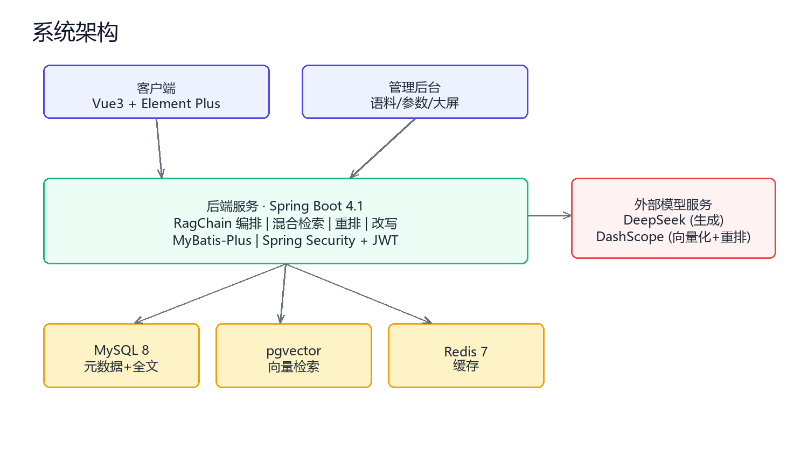

**RAG 检索增强流程（完整版）**

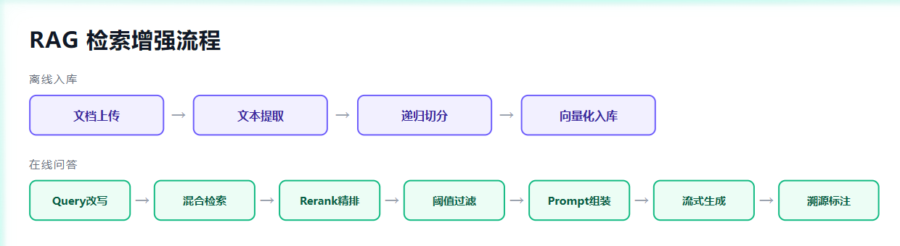

### 12.2 学生端

**欢迎页**


**登录 / 注册页**（校园大图背景，离线有兜底色）

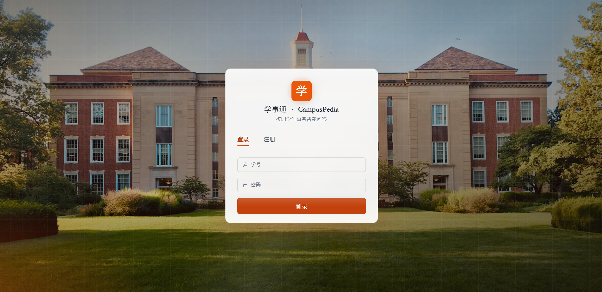

**智能问答与来源溯源**（答案末尾 `[来源N]` 可点击，展开卡片可看文件名、条款号与官网链接）

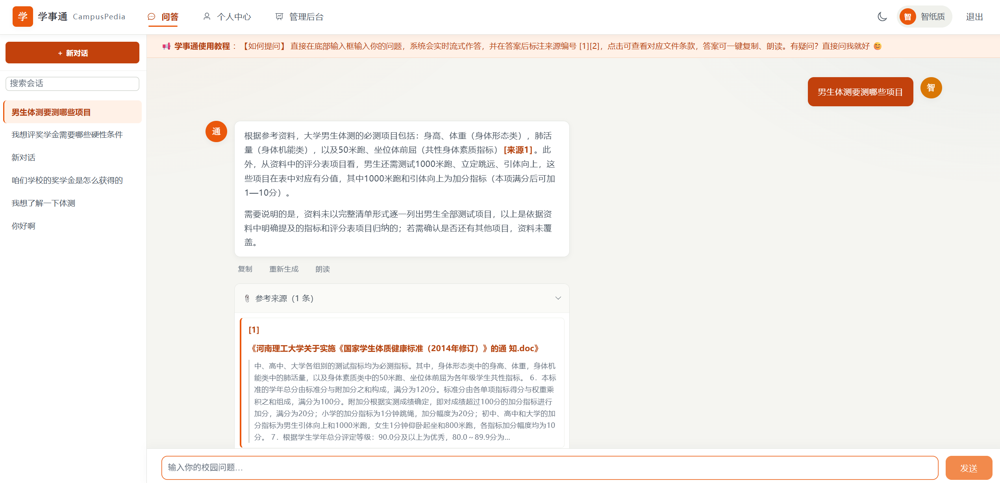

**问答页 · 引用标注**（同一来源全文只标注一次，编号可点击定位）

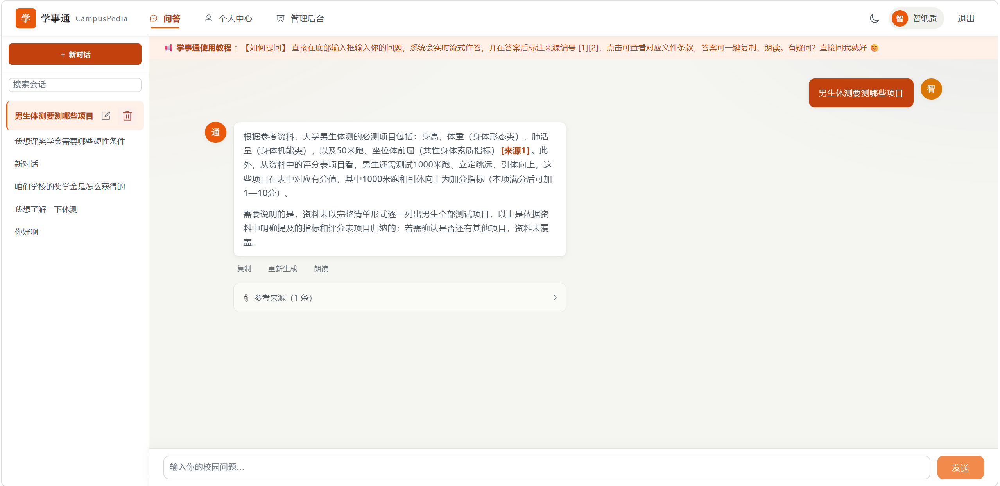

**个人中心**（基本资料、头像、修改密码与会话记录）

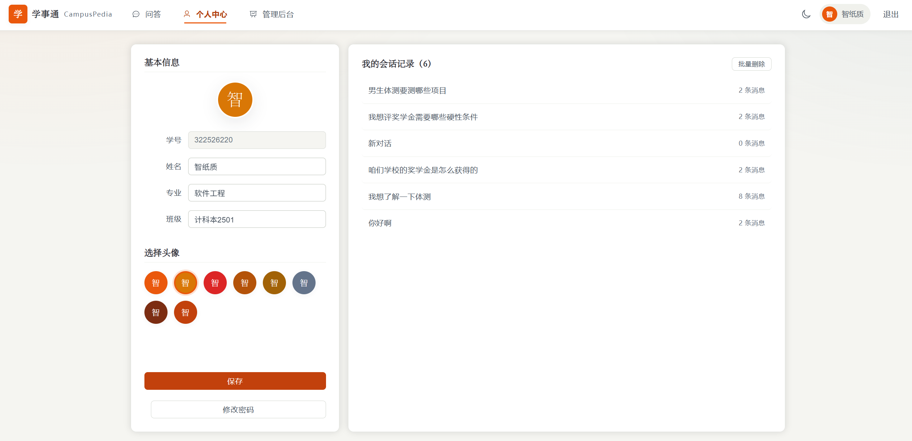

### 12.3 管理后台

**语料管理 · 分类筛选**（6 大类 + 「其他」共 7 类）

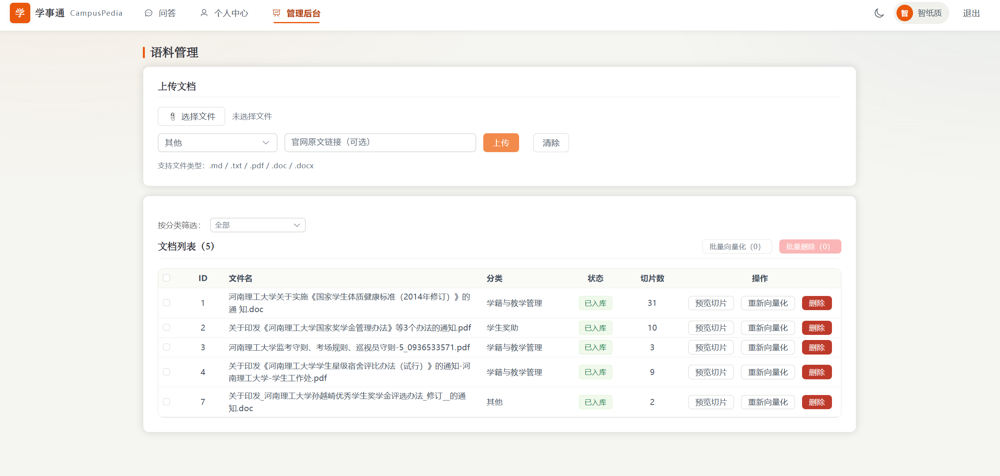

**语料上传闭环**（上传 → 切片 → 向量化 → 新文档出现在列表）

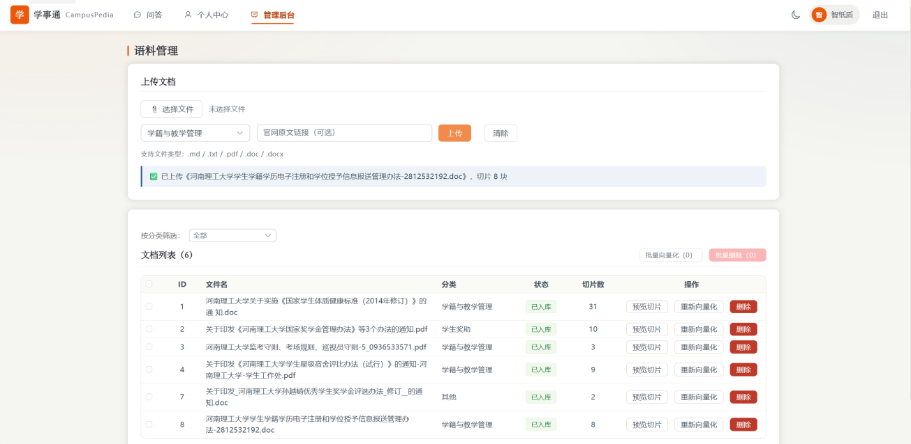

**数据大屏**（问答量趋势、语料类型分布、热门问题 TOP10）

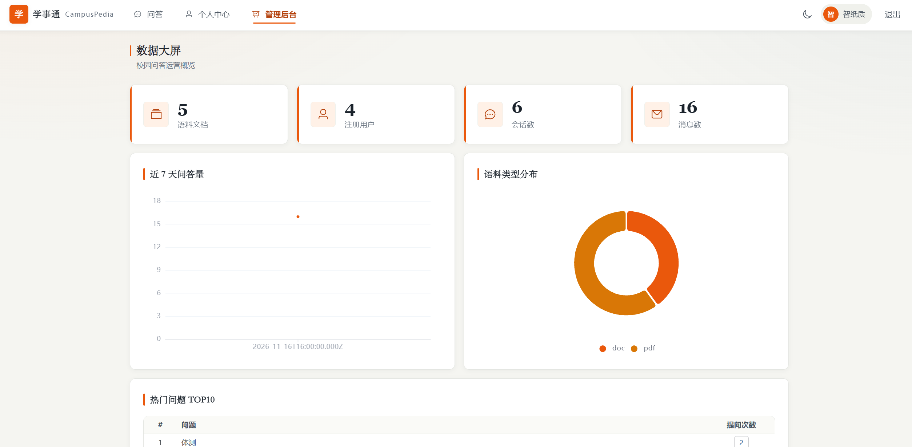

**参数配置**（切片、召回、阈值与开关均在线热更新，不用重启）

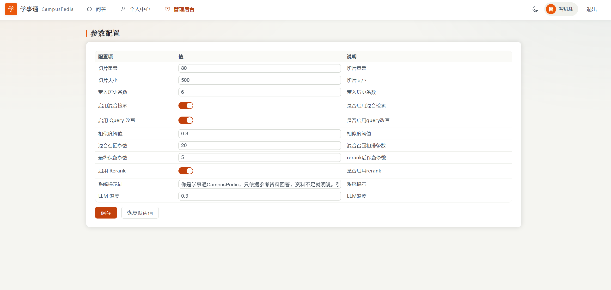

**用户管理**（角色分级、资料维护）

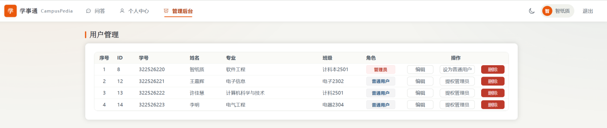

**公告管理**（系统公告发布与编辑）

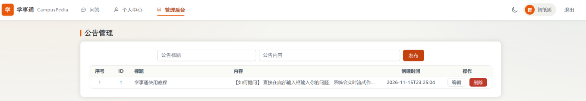

---

## 13. 开源许可证

本项目采用 [Apache License 2.0](LICENSE)：允许商用、修改与分发，需保留版权与许可声明并标注修改；按「原样」提供，不含任何担保。完整条款见仓库根目录 `LICENSE`。
