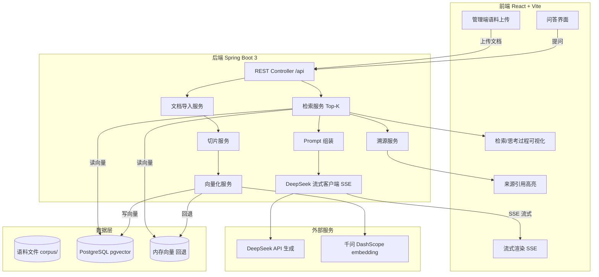

# 阶段 2 · 整体架构 + Prompt 工程策略（草案）

> 学事通 CampusPedia · 校园学生事务智能问答（RAG）
> 待用户确认后进入开发

## 一、已锁定选型

| 项 | 决定 |
|---|---|
| 产品名 | 学事通 · CampusPedia |
| 前端 | React + Vite |
| 后端 | Spring Boot 3.4.1（JDK 17）+ Maven Wrapper |
| LLM（生成） | DeepSeek API（deepseek-chat，SSE 流式）|
| Embedding（向量化） | 千问 DashScope text-embedding-v3 |
| 向量库 | pgvector(Docker) + 内存回退 |
| 语料 | 学生手册 38 篇（预置 + 管理端上传，支持补交更新）|

## 二、整体架构图



## 三、模块职责

| 模块 | 职责 | 技术要点 |
|---|---|---|
| Chat 前端 | 提问、流式渲染、引用高亮、思考可视化 | React + SSE（EventSource）|
| Admin 前端 | 语料上传、知识库增删、重新向量化 | React |
| API 层 | 统一 REST 入口（/api/chat、/api/documents）| Spring MVC |
| 文档导入 | PDF/Word/MD → 纯文本 | 后端解析（POI/PDFBox）|
| 切片 | 按条款/章节切块，保留标题上下文 | 自定义切分器 |
| 向量化 | 文本 → 向量 | 千问 DashScope |
| 向量库 | 存储 + 相似度检索 | pgvector，Docker 不可用时回退内存 |
| 检索 | Top-K 召回 | 余弦相似度 |
| Prompt 组装 | 参考资料 + 问题 → 最终 Prompt | 模板 |
| LLM 调用 | 流式生成 | DeepSeek SSE |
| 溯源 | 每个结论标注 [来源N]，映射到文件名/条款/官网链接 | 随 chunk 存元数据 |

## 四、Prompt 工程策略

### 4.1 RAG System Prompt（给 DeepSeek）

```
你是「学事通」CampusPedia，河南理工大学校园学生事务智能问答助手。
你的知识全部来自学校公开制度文件（学生手册等），只回答校园学生事务问题。

回答规则：
1. 只依据下方【参考资料】作答，严禁使用参考资料之外的信息编造。
2. 若资料不足以回答，明确回复："根据现有制度文件暂未找到明确依据，建议咨询相关部门"，不要硬答。
3. 回答要分点、简洁、先给结论；涉及金额/比例/时限/流程步骤的关键信息必须与原文逐字一致。
4. 每个结论后用 [来源N] 标注出处；可引用"《×××》第×章第×条"原文。
```

### 4.2 用户问题组装模板

```
【参考资料】
[来源1] 《河南理工大学学生学籍管理规定（修订）》第四章第十三条：……
[来源2] ……
[来源3] ……

【学生问题】
{question}

请依据上述资料回答，结论后标注 [来源N]。
```

### 4.3 检索参数

| 参数 | 取值 |
|---|---|
| 切片大小 | 300–500 字，按条款/章节边界切 |
| 重叠 | 50 字 |
| Top-K | 6 |
| 相似度阈值 | 0.5（低于则视为无相关依据）|

### 4.4 溯源引用

每个 chunk 存元数据：`{文件名, 条款号, 官网链接}`。回答中的 [来源N] 由前端高亮并可点击跳转到原文，命中「来源引用高亮」评分点。

### 4.5 反幻觉

只依据参考资料；无依据时明确告知并给部门线索，不编造——这是「实用价值」可信度的关键。

### 4.6 检索/思考可视化（正对「用户体验·思考可视化」评分点）

前端可展开"检索过程"面板，展示：检索到的 Top-K 片段、相似度分数、最终组装的 Prompt。让评委直观看到 RAG 的"思考"过程。

## 五、开发过程意图控制（Prompt 链）

每个功能模块一条完整 Prompt 链，边做边记录（用于参赛材料）：

```
1. 需求描述（人类清晰表达要什么）
2. AI 生成初版
3. 人工 review（架构、边界、异常）
4. 引导修 Bug / 重构（针对具体问题给反馈）
5. commit（对应一次提交）
```

每步原样保存，形成"3 个核心功能的完整 Prompt 链快照"。

## 六、开发顺序（里程碑 → git 提交）

| 阶段 | 内容 | 对应提交 |
|---|---|---|
| M1 | 文档导入 + 切片 + 向量化 | feat: ingestion pipeline |
| M2 | 检索 + 问答 + 溯源 | feat: rag qa + citation |
| M3 | 流式 SSE + Chat 前端 | feat: streaming chat |
| M4 | 思考可视化 + 引用高亮 | feat: trace & citation highlight |
| M5 | 管理端语料上传 | feat: admin upload |
| M6 | README 复现指南 + 文档 | docs: reproduction guide |
